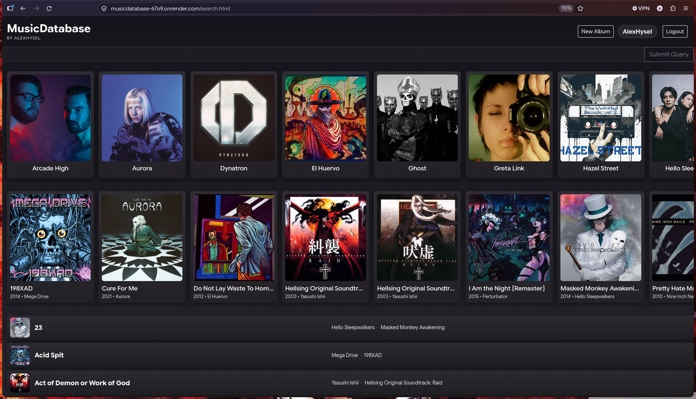

# Music Database

Music Database is a full-stack music library app for managing artists, albums, tracks, users, and user-generated tags. It combines a .NET API with a lightweight static HTML/CSS/JavaScript frontend and stores everything in PostgreSQL.

Live demo: https://musicdatabase-67o9.onrender.com

> First load may take ~1 min (free tier)



## Features

- CRUD operations for artists, albums, tracks, users, and tags
- Keyword search across artists, albums, and tracks
- JWT authentication with signup and login flow
- Role-based access control for admin actions
- Tagging on albums and tracks with user-specific tag ownership
- Automatic creation of related artist and album records when tracks are imported
- Username and password validation rules enforced in the domain model
- Image URL preview before submitting album and artist cover changes

## Technical Highlights

- Album type classification is enforced in PostgreSQL triggers: a track count determines whether an album is registered as a Single, EP, or Album.
- Read-only queries use `AsNoTracking` to reduce EF Core change tracking overhead and memory usage.
- Password hashing is handled in the service layer with BCrypt, while domain entities enforce the validation rules for user names and passwords.
- Startup is fail-fast: the application throws if the JWT key is missing and applies EF Core migrations before serving requests.

## Tech Stack

- Backend: ASP.NET Core on .NET 10
- Frontend: HTML, CSS, JavaScript
- Database: PostgreSQL with Entity Framework Core
- Auth: JWT + BCrypt password hashing
- Deployment: Docker + Render-ready configuration

## Architecture

The project is split into clear layers:

1. MusicDatabase.Domain
   - Core entities and domain validation rules
   - Username/password rules are enforced here

2. MusicDatabase.Core
   - Business logic and service layer
   - BCrypt hashing and token generation live here

3. MusicDatabase.Data
   - EF Core DbContext and persistence logic
   - Database access and migrations

4. MusicDatabase.Api
   - Controllers and static web frontend hosting
   - Startup configuration, auth setup, HTTPS redirection, and migration bootstrapping

5. MusicDatabase.Contracts
   - DTOs and request/response models

6. MusicDatabase.Tests
   - Integration tests covering service behavior and regression cases

## Domain Rules

Entities enforce their own invariants (see docstrings in `MusicDatabase.Domain`). Here's some of them:

- **Album:** must have an artist and at least one track; release year is 1900 – current year + 1; type (Single/EP/Album) is set by a PostgreSQL trigger based on track count
- **User:** username 3–20 chars, password 8–30 chars, no whitespace; passwords are hashed with BCrypt
- **Tag:** max 20 chars, normalized to lowercase

## Local Setup

### Prerequisites

- .NET 10 SDK
- PostgreSQL instance
- Optional: Docker

### Environment variables

Set the following before running the app locally or in deployment:

- ConnectionStrings__Default
- Jwt__Key

Example:

```bash
export ConnectionStrings__Default="Host=localhost;Database=musicdatabase;Username=postgres;Password=postgres"
export Jwt__Key="your-super-secret-key"
```

Render uses double underscores in environment variable names, so the app expects names like:

- ConnectionStrings__Default
- Jwt__Key

### Run locally

```bash
dotnet restore

dotnet run --project MusicDatabase.Api
```

The application automatically applies database migrations on startup and redirects root requests to the search page.

## Docker

A Dockerfile is included for containerized deployment.

Build:

```bash
docker build -t musicdatabase .
```

Run:

```bash
docker run -p 8080:8080 \
  -e ConnectionStrings__Default="Host=...;Database=...;Username=...;Password=..." \
  -e Jwt__Key="your-super-secret-key" \
  musicdatabase
```

## Deployment Notes

The app is configured to:

- fail on missing JWT key
- force HTTPS redirection
- apply EF Core migrations during startup
- expose the API on port 8080 in Docker

This makes it suitable for deployment on Render or similar hosting providers.

## Testing

Run the test suite with:

```bash
dotnet test
```

The project includes integration tests for repository and service flows, including album, track, artist, tag, and user behavior. Current coverage includes tag add/remove cycles, duplicate protection checks, and validation scenarios around username/password and entity rules.

## Planned Improvements

- Reviews and rating system
- User profile pages with review history
- Tag-based filtering and advanced discovery
- Additional analytics and recommendations
- Artist summary pages and richer artist-level insights
- Albums can have more than one Artist